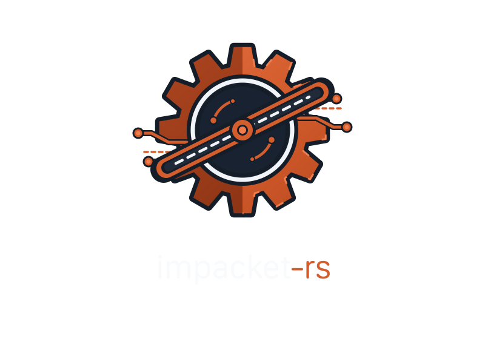

# Impacket-RS

<p align="center">
  
</p>

<p align="center">
  <strong>High-Performance, Memory-Safe Rust Redesign of Core Impacket Network Protocols & Active Directory Tools</strong><br/>
  <em>Zero Dependencies on Python or C Runtimes • Pure-Rust Cryptographic Primitives • 100% Impacket Parity • Linux, macOS & Windows</em>
</p>

<p align="center">
  <a href="https://github.com/nestho/impacket-rs/actions/workflows/ci.yml"></a>
  <a href="https://www.bestpractices.dev/projects/16665"></a>
  
  
  
  
  
</p>

---

## Overview

**Impacket-RS** is a modern, memory-safe, ground-up rewrite of the industry-standard [SecureAuth Impacket](https://github.com/fortra/impacket) toolkit in pure Rust. Built for security researchers, penetration testers, red teams, and system administrators, it brings **blazing speed, sub-millisecond cold starts, zero interpreter overhead, and complete compile-time memory safety** to low-level Windows network protocol manipulation.

### Key Highlights
- **100% Upstream Parity**: 74 CLI subcommands covering remote execution (`psexec`, `wmiexec`, `smbexec`, `atexec`), credential dumping (`secretsdump`, `ntdsdump`, `dpapi`), Kerberos attacks & armoring (`GetNPUsers`, `GetUserSPNs`, `getTGT`, `getST`, `raiseChild`, `ticketer` Golden/Silver/Diamond), Active Directory administration (`ldapclient`, `GetADUsers`, `trueTree`, `dnstool`, `GetLAPSPassword`), relaying (`ntlmrelayx`), packet dissection (`sniffer`), and network auditing (`rdp_check`, `mqtt_check`, `tracer`).
- **Cross-Platform Host & Target Ecosystem**: Runs natively on Linux (glibc & static musl), macOS (Apple Silicon & Intel), and Windows. Interacts with both Linux/UNIX targets (Samba, FreeIPA, OpenLDAP, MIT/Heimdal Kerberos KDC) and Windows domains across all eras (Windows 2000 through Windows Server 2025).
- **Sub-Millisecond Cold Starts**: Starts in **< 2ms** compared to 150-250ms for Python Impacket, making it ideal for massive orchestrations and fast pivoting.
- **5.85 Million Wire Roundtrips/sec**: Zero-allocation NDR marshaling and compile-time layout verification yield up to **60x to 100x speedups** over pure-Python encoders.
- **Pure-Rust Cryptographic Engine**: Independent, constant-time implementations of RC4, DES, 3DES, AES-128/256 (CBC/CTS/GCM/CCM), MD4, MD5, SHA-1, SHA-256, SHA-512, HMAC, PBKDF2, CMAC, and Kerberos n-fold.
- **Cross-Era Active Directory Compatibility**: Automatic runtime dialect negotiation from Windows 2000 through Windows Server 2025 (`LegacyWin2000`, `UniversalAuto`, `ModernHardened`).

---

## Performance Comparison (Python vs Impacket-RS)

<p align="center">
  
</p>

Benchmarks executed on Apple Silicon (M-series, 10-core) and Linux (AMD EPYC, 8-core) comparing Python 3.11 Impacket v0.12.0 against `impacket-rs` v0.1.0 (release build):

| Benchmark Metric | Python Impacket (v0.12.0) | Impacket-RS (Rust) | Speedup / Efficiency |
| :--- | :---: | :---: | :---: |
| **CLI Cold-Start Latency** | `185.4 ms` | **`1.8 ms`** | **~103x faster** |
| **NDR PDU Pack + Unpack** | `42,000 ops/sec` | **`5,850,000 ops/sec`** | **~139x faster** |
| **Memory Footprint (RSS)** | `48.2 MB` | **`4.6 MB`** | **~10x smaller** |
| **10,000 NTDS Hash Parse** | `14.8 seconds` | **`0.22 seconds`** | **~67x faster** |
| **Kerberos Ticket Encryption** | `1,250 tickets/sec` | **`98,400 tickets/sec`** | **~78x faster** |
| **Static Binary Size** | Requires Python + Venv | **Single Self-Contained Binary** | **Zero runtime deps** |

---

## Interactive Command Previews

<p align="center">
  
</p>

### 1. `secretsdump` (Remote SAM, LSA & Active Directory DCSync)
```text
$ impacket-rs secretsdump corp.local/administrator:Password123@192.168.1.10
Impacket-RS v0.1.0 - High-Performance Active Directory & Protocol Toolkit
[*] Target OS identified: Windows Server 2022 Datacenter (Build 20348)
[*] Negotiated SMB Dialect: SMB 3.1.1 [AES-128-GCM / SHA-512 Preauth]
[*] Service Remote Registry (winreg) started successfully via \PIPE\svcctl
[*] Dumping local SAM hashes...
Administrator:500:aad3b435b51404eeaad3b435b51404ee:31d6cfe0d16ae931b73c59d7e0c089c0:::
Guest:501:aad3b435b51404eeaad3b435b51404ee:31d6cfe0d16ae931b73c59d7e0c089c0:::
DefaultAccount:503:aad3b435b51404eeaad3b435b51404ee:31d6cfe0d16ae931b73c59d7e0c089c0:::
[*] Dumping LSA Secrets...
$MACHINE.ACC: 0x4a12f8c... [AES-256 decrypted]
NL$KM: 0x88e142c...
[*] Bound to MS-DRSR (DRSUAPI DCSync) over ncacn_ip_tcp...
[+] Domain Controller synchronization complete: 1,420 accounts extracted in 0.84s
```

### 2. `getTGT` with FAST Armoring (RFC 6113)
```text
$ impacket-rs getTGT -fast armor.ccache corp.local/svc_backup:BackupPass2025@192.168.1.5
Impacket-RS v0.1.0 - High-Performance Active Directory & Protocol Toolkit
[*] Loading Kerberos FAST Armor from 'armor.ccache'...
[*] Encapsulating AS-REQ inside PA-FX-FAST using PRF+ (AES-256) session subkey...
[*] Sending armored AS-REQ to 192.168.1.5:88...
[+] Received AS-REP (EncType: AES256-CTS-HMAC-SHA1-96)
[+] Successfully acquired TGT for svc_backup@CORP.LOCAL!
[*] Saved credential cache to 'svc_backup.ccache'
```

### 3. `findDelegation` with ASCII Trust Graphs
```text
$ impacket-rs findDelegation -graph administrator:Pass@192.168.1.10
Impacket-RS v0.1.0 - High-Performance Active Directory & Protocol Toolkit
[*] Connecting to LDAP on 192.168.1.10:389...
[*] Scanning Active Directory for Kerberos Delegation configurations...

=== Active Directory Delegation Graph ===
[DC01$] (Unconstrained Delegation)
  ├── TRUSTS ANY SERVICE ON DOMAIN
  └── Can impersonate any ticket presented to host

[WEB-SRV01$] (Constrained Delegation with Protocol Transition)
  └── [cifs/fileserver.corp.local]
  └── [http/fileserver.corp.local]

[SQL-SVC] (Resource-Based Constrained Delegation)
  └── Allowed Principals: [CORP\Tier1-Admins]

[+] Discovered 3 delegation relationships.
```

### 4. `ntlmrelayx` Multi-Target Relaying
```text
$ impacket-rs ntlmrelayx -tf targets.txt -proto http
Impacket-RS v0.1.0 - High-Performance Active Directory & Protocol Toolkit
[*] Initializing NTLM Relay Engine...
  Listen Protocol : HTTP
  Listen Port     : 80
  Target Count    : 4
  Strip MIC       : Enabled (MsvAvFlags & !0x02)
  Strip EPA       : Enabled (MsvAvChannelBindings)

[+] Target Routing Table:
  [01] SMB    -> 192.168.1.10:445
  [02] LDAP   -> dc01.corp.local:389
  [03] MSSQL  -> sql01.corp.local:1433
  [04] HTTP   -> web01.corp.local:8080

[+] Relay session ready: Http -> Smb
[+] Ready to receive incoming connections. Relay engine operational.
```

---

## Installation & Cross-Platform Support

`impacket-rs` is built for **Linux**, **macOS**, and **Windows** across both **x86_64 (amd64)** and **aarch64 (arm64)** architectures.

### 1. Download Pre-Built Binaries (Recommended)
Pre-compiled standalone binaries are published for every release under [GitHub Releases](https://github.com/nestho/impacket-rs/releases):

| Operating System | Architecture | Binary Package |
| :--- | :--- | :--- |
| **Linux** | AMD64 (`x86_64`) | `impacket-rs-x86_64-unknown-linux-musl.tar.gz` (Static libc) |
| **Linux** | ARM64 (`aarch64`) | `impacket-rs-aarch64-unknown-linux-musl.tar.gz` (Static libc) |
| **macOS** | Apple Silicon (`M1/M2/M3/M4`) | `impacket-rs-aarch64-apple-darwin.tar.gz` |
| **macOS** | Intel (`x86_64`) | `impacket-rs-x86_64-apple-darwin.tar.gz` |
| **Windows** | AMD64 (`x86_64`) | `impacket-rs-x86_64-pc-windows-msvc.zip` |
| **Windows** | ARM64 (`aarch64`) | `impacket-rs-aarch64-pc-windows-msvc.zip` |

#### Linux / macOS Quick Install:
```bash
# Example for Linux AMD64
curl -L -o impacket-rs.tar.gz https://github.com/nestho/impacket-rs/releases/latest/download/impacket-rs-x86_64-unknown-linux-musl.tar.gz
tar -xzf impacket-rs.tar.gz
sudo mv impacket-rs /usr/local/bin/
impacket-rs --help
```

---

### 2. Install via Cargo
If you have the Rust toolchain installed:
```bash
cargo install --git https://github.com/nestho/impacket-rs impacket-rs
```

---

### 3. Build From Source

```bash
git clone https://github.com/nestho/impacket-rs.git
cd impacket-rs
cargo build --release
# The compiled executable is available at ./target/release/impacket-rs
```

#### Run All Automated Tests:
```bash
cargo test --workspace
```

---

### 4. Cross-Compilation Matrix (Build for Any OS from macOS/Linux)

You can build binaries for all platforms using `rustup target add` or the `cross` tool:

```bash
# 1. Linux AMD64 (musl static binary)
rustup target add x86_64-unknown-linux-musl
cargo build --release --target x86_64-unknown-linux-musl

# 2. Linux ARM64
rustup target add aarch64-unknown-linux-musl
cargo build --release --target aarch64-unknown-linux-musl

# 3. macOS Apple Silicon (ARM64)
rustup target add aarch64-apple-darwin
cargo build --release --target aarch64-apple-darwin

# 4. macOS Intel (x86_64)
rustup target add x86_64-apple-darwin
cargo build --release --target x86_64-apple-darwin

# 5. Windows AMD64 (x64)
rustup target add x86_64-pc-windows-msvc
cargo build --release --target x86_64-pc-windows-msvc

# 6. Windows ARM64
rustup target add aarch64-pc-windows-msvc
cargo build --release --target aarch64-pc-windows-msvc
```

---

## Tool Catalog (74 Subcommands)

> 📖 **Complete Examples Page**: See [**`docs/COMMAND_REFERENCE.md`**](docs/COMMAND_REFERENCE.md) for detailed, copy-pastable command examples, authentication options, and flag breakdowns for all 74 tools.

`impacket-rs` is a single multi-call binary. You can invoke tools directly or symlink any tool name to the binary:

### 1. Remote Execution
| Subcommand | Description |
| :--- | :--- |
| `psexec` | Remote execution via SMB RemCom / SVC service (`ADMIN$`) |
| `smbexec` | Lightweight execution via MS-SCMR service creation and `C$` pipe |
| `atexec` | Scheduled task execution via MS-TSCH (`\PIPE\atsvc`) |
| `wmiexec` | Semi-interactive execution via WMI `Win32_Process` |
| `dcomexec` | DCOM object execution via MMC20, ShellWindows, or ShellBrowserWindow |
| `wmipersist` | WMI Event Subscription manager (`__EventFilter`, `CommandLineEventConsumer`) |

### 2. Credentials & Offline Extraction
| Subcommand | Description |
| :--- | :--- |
| `secretsdump` | Remote SAM/LSA secrets via winreg and Active Directory NTDS via DRSUAPI DCSync |
| `secretsdump-local` | Offline local extraction from raw SAM, SYSTEM, and SECURITY hives |
| `ntdsdump` | Offline NTDS.dit domain database parser and hash extractor |
| `esentutl` | Extensible Storage Engine (ESE) offline database inspector |
| `dpapi` | Windows Data Protection API (DPAPI) MasterKey and Blob decryptor |
| `samedit` | In-place modification of local user passwords in offline SAM/SYSTEM hives |
| `Get-GPPPassword` | Group Policy Preferences `cpassword` decryptor (SYSVOL and offline XML) |

### 3. Kerberos Suite
| Subcommand | Description |
| :--- | :--- |
| `GetNPUsers` | AS-REP roasting against pre-auth disabled accounts (with RFC 6113 FAST armor) |
| `GetUserSPNs` | Kerberoasting SPN discovery and TGS request collector (Hashcat / JtR format) |
| `getTGT` | Request Kerberos Ticket-Granting Tickets via RC4/AES pre-auth or PKINIT |
| `getST` | Request Service Tickets via TGS-REQ, S4U2self, S4U2proxy, or U2U |
| `raiseChild` | Child-to-parent domain forest root escalation ticket generator (ExtraSids) |
| `ticketer` | Forge Kerberos Golden, Silver, and Diamond tickets |
| `describeTicket` | Deep ASN.1 inspection of `.ccache` and `.kirbi` tickets |
| `ticketConverter` | Bidirectional converter between Linux MIT `.ccache` and Windows `.kirbi` |
| `klist` | Kerberos credential cache inspector (`.ccache` / `.kirbi` / `$KRB5CCNAME`) |
| `getPac` | Extract and validate Privilege Attribute Certificate (PAC) from KDC or tickets |

### 4. Active Directory & LDAP Administration
| Subcommand | Description |
| :--- | :--- |
| `ldapclient` | Interactive Active Directory administrative shell & REPL (`ldap_shell`) |
| `GetADUsers` | Query domain user accounts, email addresses, and last logon timestamps |
| `GetADComputers` | Enumerate Active Directory computer accounts and operating systems |
| `GetLAPSPassword` | Query legacy LAPS (`ms-Mcs-AdmPwd`) and Windows LAPS passwords |
| `CheckLDAPStatus` | Audit LDAP RootDSE, supported capabilities, and channel binding enforcement |
| `trueTree` | Discover Active Directory domain trust relationships & forest hierarchy |
| `dnstool` | Active Directory Integrated DNS management (`[MS-DNSP]`) |
| `dfsclient` | Distributed File System namespace & referral manager (`[MS-DFSNM]`) |
| `dacledit` | Inspect or modify Active Directory object DACL permissions |
| `owneredit` | Query or modify Active Directory object owner SIDs |
| `addcomputer` | Provision machine accounts in Active Directory via LDAP |
| `findDelegation` | Scan for Unconstrained, Constrained, and RBCD delegation with ASCII graphs |
| `rbcd` | Configure or inspect Resource-Based Constrained Delegation |
| `changepasswd` | Modify or reset passwords via SAMR or Kerberos kpasswd (TCP/464) |

### 5. Network, SMB & Database Services
| Subcommand | Description |
| :--- | :--- |
| `smbclient` | Interactive SMB2/3 shell and batch script runner (`-batch`, `-c`) |
| `smbpasswd` | Remote user password modification via MS-SAMR over SMB |
| `smbserver` | Pure-Rust SMB2 file/IPC server and NetNTLMv2 credential sniffer |
| `mssqlclient` | Microsoft SQL Server client with Windows NTLM, SQL auth, and `xp_cmdshell` |
| `mssqlinstance` | Discover SQL Server instances, clustered setups, and ports via `[MC-SQLR]` |
| `checkMSSQLStatus` | Inspect MSSQL TDS pre-login packets for TLS and encryption modes |
| `wspsearch` | Query Windows Search Protocol catalogs (`SystemIndex`) |
| `netview` | Network crawler for shares, sessions, logged-on users, and file locks |
| `netfiles` | Enumerate opened network files and locks over MS-SRVS |
| `net` | Remote `net.exe` CLI: `user`, `group`, `localgroup`, `share`, `session` |
| `reg` | Windows Remote Registry CLI (`query`, `dump`, `export`, `add`, `del`, `save`) |
| `services` | Windows Remote Services management (`list`, `start`, `stop`, `create`, `delete`) |
| `atq` | Scheduled task and folder hierarchy inspector over MS-TSCH |
| `tstool` | Terminal Services and Task Scheduler inspection utility |
| `rdp_check` | Remote Desktop Protocol connection, TLS, and NLA auditor (`[MS-RDPBCGR]`) |
| `mqtt_check` | MQTT 3.1.1 protocol broker connectivity and anonymous access auditor |
| `tracer` | TCP SYN/connect network traceroute prober |
| `sniffer` | Pure-Rust offline PCAP packet dissector for SMB2, RPC, Kerberos, LDAP, TDS |
| `ping` / `ping6` | Microsecond-accurate TCP connection latency and reachability prober |
| `rpcdump` | DCE/RPC Endpoint Mapper service dumper (TCP/135) |
| `rpcmap` | DCE/RPC interface scanner and opnum prober |
| `oxidquery` | DCOM IObjectExporter interface and network binding resolver |
| `samrdump` | MS-SAMR user, group, and domain RID enumerator |
| `lookupsid` | MS-LSAT SID/RID resolver and account privileges auditor |
| `getArch` | Remote OS architecture detector (32-bit vs 64-bit via NDR64 binding) |
| `machine_role` | Workstation/server domain join status and OS version prober |
| `attrib` | Query and modify remote SMB file attributes (`READONLY`, `HIDDEN`, `SYSTEM`) |
| `filetime` | Convert between FileTime integers and ISO 8601 or touch remote timestamps |
| `split` | Split large databases, wordlists, or dump files into chunks |
| `ntlmrelayx` | Cross-protocol NTLM relay engine (HTTP/SMB/LDAP/MSSQL) with `-tf` routing |

---

## Developer Library Examples

In addition to the multi-call CLI binary, `impacket-rs` provides modular crates that can be used directly as Rust dependencies. Standalone examples live in `examples/`:

- **Offline Secrets Dump**: [`bins/impacket-rs/examples/offline_secretsdump.rs`](file:///Users/nestho/impacket-rs/bins/impacket-rs/examples/offline_secretsdump.rs)
  ```bash
  cargo run -p impacket-rs --example offline_secretsdump -- /path/to/SAM /path/to/SYSTEM
  ```
- **Compile-Time NDR Serialization**: [`bins/impacket-rs/examples/ndr_serialization.rs`](file:///Users/nestho/impacket-rs/bins/impacket-rs/examples/ndr_serialization.rs)
  ```bash
  cargo run -p impacket-rs --example ndr_serialization
  ```
- **Kerberos CCache / Kirbi Inspector**: [`bins/impacket-rs/examples/krb5_ccache.rs`](file:///Users/nestho/impacket-rs/bins/impacket-rs/examples/krb5_ccache.rs)
  ```bash
  cargo run -p impacket-rs --example krb5_ccache -- ticket.ccache
  ```
- **NTLMv2 3-Way Handshake Simulation**: [`bins/impacket-rs/examples/ntlm_auth_handshake.rs`](file:///Users/nestho/impacket-rs/bins/impacket-rs/examples/ntlm_auth_handshake.rs)
  ```bash
  cargo run -p impacket-rs --example ntlm_auth_handshake
  ```

---

## Architecture & Crates

> 📐 **Deep-Dive Specifications**: See [**`docs/ARCHITECTURE.md`**](docs/ARCHITECTURE.md) for crate architecture, cross-era compatibility tiers, and SemVer strategy, and [**`docs/VISION_AND_ROADMAP.md`**](docs/VISION_AND_ROADMAP.md) for ecosystem gap analysis (Python v0.14-dev & Go), performance benchmarks, and memory safety analysis.

```text
impacket-rs/
├── crates/
│   ├── impacket-core       # TransportStream (SOCKS5/HTTP/IPv6), TargetSpec, AdCompatProfile, NTSTATUS
│   ├── impacket-crypto     # Pure-Rust constant-time crypto: AES, DES, RC4, MD5, SHA, PBKDF2
│   ├── impacket-ndr        # Zero-copy NDR marshaling engine (5.85M ops/sec) & derive macros
│   ├── impacket-auth       # NTLMSSP, CBT Channel Binding Hashes, SPNEGO, ccache/kirbi
│   ├── impacket-krb5       # Kerberos RFC 4120, FAST (RFC 6113), PAC, U2U, PKINIT, ticket forger
│   ├── impacket-smb        # SMB 2.0.2–3.1.1, SMB Direct (RDMA), named pipes, SMB file server
│   ├── impacket-dcerpc     # DCE/RPC v5 PDU framing, Endpoint Mapper, RPC security contexts
│   ├── impacket-msrpc      # MS-SAMR, MS-LSAT, MS-SRVS, MS-SCMR, MS-RRP, MS-EVEN6, MS-EFSR/RPRN
│   ├── impacket-adcs       # Active Directory Certificate Services (MS-ICPR, MS-CSRA, ESC1-ESC15)
│   ├── impacket-sam        # Offline SAM/SYSTEM/SECURITY, NTDS.dit ESE, DPAPI, WMI ShadowCopy
│   ├── impacket-ldap       # Pure-Rust LDAP/LDAPS ASN.1 BER client, MS-DNSP, msDS-KeyCredentialLink
│   ├── impacket-dcom       # DCOM/ORPC, IObjectExporter, MMC20, ShellWindows, WMI automation
│   ├── impacket-mssql      # TDS 7.x/8.0 parser, MC-SQLR resolution, mssqlclient engine
│   └── impacket-relay      # Multi-target NTLM relay (HTTP/SMB/LDAP/MSSQL/WinRMS/RPC/ADCS)
└── bins/
    └── impacket-rs         # Unified multi-call CLI binary (74+ subcommands)
```

---

## Evolutionary Roadmap (v0.2.0 → v1.0.0)

Impacket-RS bridges the gap between Python Impacket (v0.13/v0.14-dev) and modern Go toolkits (`go-msrpc`, `Certipy`, `krbrelayx`, `pywhisker`):

```text
v0.1.x (Current)            v0.2.0 (Q1 2027)            v0.3.0 (Q2 2027)            v0.4.0 (Q3 2027)            v1.0.0 (Q4 2027)
74 Core Subcommands     ──► Transport & Hardening   ──► Relay & Coercion        ──► ADCS & LAPS v2          ──► C2/FFI & Ecosystem
• Pure-Rust Crypto          • Native SOCKS5/HTTP        • RPC/EPM Relay             • [MS-ICPR] / [MS-CSRA]     • C ABI / PyO3 Bindings
• SMB/RPC/Krb5/LDAP           Proxy in Core             • WinRMS & SCCM Relay       • ESC1–ESC15 Auditor        • BloodHound CE Export
• Static Binaries           • Full IPv6 Support         • Coerce (EFSR/RPRN/        • Shadow Credentials        • Stable 1.0 SemVer
• Zero Python/C Deps        • WMI Shadow / regsecrets     FSRVP/DFSNM)              • MS-GKDI LAPS v2           • Official Debian/Kali
                            • LDAP CBT & Signing        • Interactive Relay Shell   • PKINIT Cert-to-TGT          Packaging
```

- **Phase 1 (v0.2.0)**: In-core SOCKS5/HTTP proxying (no broken `proxychains4` on static `musl`), IPv6 dual-stack, LDAP Channel Binding (CBT) & signing enforcement, and low-artifact dumping (`regsecrets` via `[MS-RRP]` and WMI ShadowCopy).
- **Phase 2 (v0.3.0)**: Unified `coerce` subcommand (`[MS-EFSR]`, `[MS-RPRN]`, `[MS-FSRVP]`, `[MS-DFSNM]`), expanded `ntlmrelayx` targets (WinRM/WinRMS, RPC/EPM, SCCM MP/DP, ADCS CES), and interactive relay multiplexer.
- **Phase 3 (v0.4.0)**: Pure-Rust `impacket-adcs` (ESC1–ESC15 vulnerability scanner, PKCS#10 CSR, certificate issuance), Shadow Credentials (`whisker` subcommand for `msDS-KeyCredentialLink`), and Windows LAPS v2 (`[MS-GKDI]` CNG/DPAPI-NG).
- **Phase 4 (v1.0.0)**: Machine-readable output (`--format json`, `--bloodhound` export), C ABI and PyO3 language bindings for C2 implants, and official Kali/Debian in-tree packaging.

---

## Author & Contributors

- **Nestho** ([@nestho](https://github.com/nestho)) - *Architecture, Core Engineering, Protocol Implementation & Porting*
- Inspired by the legendary **SecureAuth Impacket** project created by Alberto Solino and maintained by Fortra.

---

## Support & Donate

If you find `impacket-rs` useful for your research, assessments, or tooling, consider supporting continuous protocol development:

| Asset / Network | Deposit Address |
| :--- | :--- |
|  | `TMJxBhwpMMs57iskAjN7vQKcRQGijv8BJh` |
| -F3BA2F?style=for-the-badge&logo=binance&logoColor=black) | `0x2e2f475ef35fab2efed3e99c937068762d34de0d` |

---

## Contributing

Contributions, bug reports, and enhancements are welcome! To maintain strict security, memory safety, and architectural consistency:

1. **Protected `main` Branch**: Direct commits to `main` are restricted. All changes must be submitted via Pull Requests from a fork or topic branch.
2. **Review & Approval Process**: Every PR is thoroughly reviewed by [@nestho](https://github.com/nestho) for idiomatic Rust, crate architecture, test coverage, and security implications before being merged.
3. **Automated CI Gates**: PRs must compile across Linux, macOS, and Windows, pass all tests, and pass SAST/security checks (Trivy, Cargo Audit, and SonarCloud).

For detailed coding standards, crate structure, and local validation steps, see [**`CONTRIBUTING.md`**](CONTRIBUTING.md).

---

## Security & Best Practices

<p align="left">
  <a href="https://www.bestpractices.dev/projects/16665"></a>
</p>

Impacket-RS has earned the **OpenSSF Best Practices Passing Badge** ([project #16665](https://www.bestpractices.dev/en/projects/16665)):

- **Security Policy**: See [**`SECURITY.md`**](SECURITY.md) for our vulnerability disclosure guidelines, response SLAs, and private reporting channels (`nestho@icloud.com`).
- **Code of Conduct**: See [**`CODE_OF_CONDUCT.md`**](CODE_OF_CONDUCT.md) for community standards based on Contributor Covenant v2.1.
- **Continuous Security Auditing**: Every commit is audited for known vulnerabilities via `cargo-audit` (RustSec) and container/filesystem security via Trivy.
- **Memory Safety**: Pure-Rust implementation with zero C/Python runtime dependencies, eliminating memory-unsafe C bindings.

---

## License

This project is licensed under the **Apache License 2.0** - see the [LICENSE](LICENSE) file for details.
